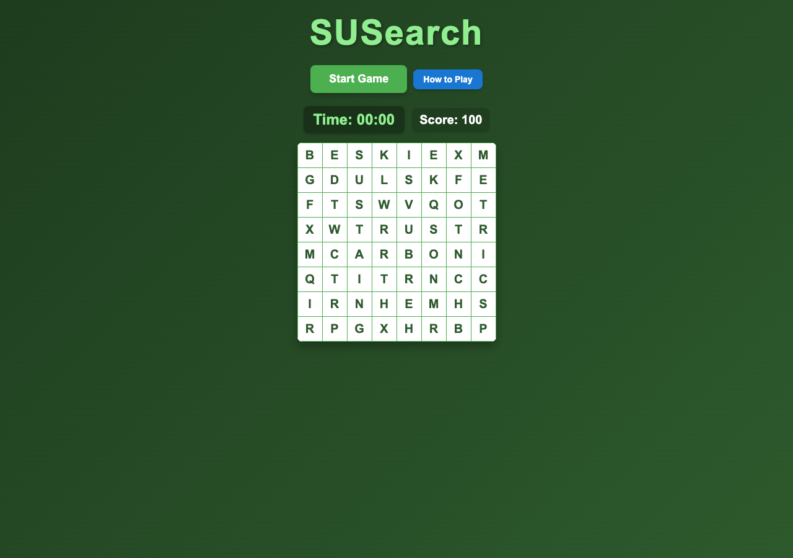

# Suspicious Search (SUSearch) — Exposing Greenwashing Bias in Sustainability Reports



## About
Suspicious Search (SUSearch) — A hackathon project that turns corporate sustainability reports into a word-search game designed to expose greenwashing and confirmation bias. By scanning reports against GRI standards and flagging vague, unquantified claims, the game makes missing metrics and marketing language visible to players. I led the portfolio-ready cleanup: consolidated ~44 commits into one, removed exposed credentials and rough filenames, added a one-command launcher, offline deterministic demo mode, MIT licensing, and clear documentation. The original team repo remains intact.

**Hackathon project (hackthebias2026).** SUSearch turns corporate sustainability
reports into a word-search game that highlights confirmation bias and
greenwashing: missing GRI standards, vague "fluff" language, and metrics that
are claimed but never quantified. Players find the terms, then see which claims
a report fails to back with data.

## What it does
- Downloads real sustainability reports (Deloitte, PwC, EY, Nestlé, …) and
  analyzes them against GRI standards.
- Flags missing standards, misleading language, and bias words (e.g. "proud",
  "leader", "committed") that lack supporting data.
- Generates a word-search puzzle whose clues point at those gaps, so players
  learn to spot greenwashing instead of trusting the headline.

## Run locally (one command)

```bash
git clone <repo-url>
cd hackthebias2026
./start
```

`./start` creates a virtualenv, installs dependencies, starts the backend, and
opens the frontend at http://localhost:5001. Press `Ctrl+C` to stop.

The app ships in **example mode**: games are served from pre-generated traces
in `traces.json`, so it runs fully offline and deterministically with no API
key and no model download.

## Add the AI back in (needs an API key)
The deterministic example mode lives in `generate_game_data()` in `main.py`.
To generate fresh games from real PDFs with an LLM:

1. Copy `.env.example` to `.env`.
2. Set a backend + key, e.g.:
   ```env
   ANTHROPIC_API_KEY=sk-ant-...
   LLM_BACKEND=anthropic
   ```
   (or point `LLM_BACKEND=openai` at any OpenAI-compatible local server.)
3. Replace the body of `generate_game_data()` with the PDF pipeline:
   download a PDF -> `PDFScraper` -> `analyze_gri_compliance()` ->
   `extract_company_name()` -> `generate_words_from_pdf()`.
   Those helpers are still in `main.py` and ready to use.

## Repository layout
- `main.py` — Flask backend + GRI analysis + game generation.
- `game.html` — playable word-search frontend.
- `search.html` — alternate search UI.
- `traces.json` — pre-generated example games.
- `sustainability_project/` — standalone research prototype.
- `logicandprocessing/research.py` — PDF/GRI research utilities.

## License
MIT — see `LICENSE`.